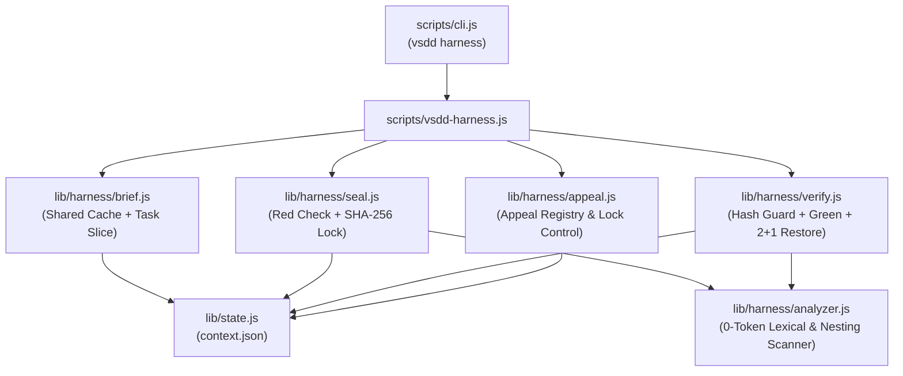

# Plan 001 Test Harness Antifraude, Contexto Inteligente y Tribunal de Calidad

Estado: listo-para-tareas

Idea: `docs/sdd/vsdd/001-test-harness-tribunal/idea.md`
Spec: `docs/sdd/vsdd/001-test-harness-tribunal/spec.md`

## Alineación

Este plan técnico materializa la separación estricta entre creación de pruebas y escritura de código en VSDD sin añadir dependencias externas ni inflar el consumo de tokens:
- **Separación de Planos (Principio 10):** El nuevo comando `vsdd harness` ejecuta en Node.js puro (0 tokens y menos de 100 ms) el ensamblaje de contexto inteligente por trazabilidad, el sellado criptográfico SHA-256 de tests en estado Rojo, el escaneo estructural anti-espagueti y el cortacircuitos físico 2+1 con `git restore`.
- **Higiene de Atención (Principio 11):** El ensamblador cachea el Contexto Compartido una sola vez por fase y lo fusiona con el Corte Específico de la Tarea activa sin recortar líneas esenciales.
- **Diseño para Testabilidad (Principio 8):** Todos los módulos de `scripts/lib/harness/` separan la lógica pura de evaluación léxica y cálculo de estado respecto a los efectos secundarios de disco/subprocesos mediante inyección de ejecutores (`runnerFn` y `gitFn`).
- **Compatibilidad Total:** Los comandos existentes (`vsdd status`, `vsdd validate`, `vsdd oracle`, `vsdd sonar`) mantienen intactos sus contratos y firmas.

## Módulos y arquitectura

- **Router CLI (`scripts/cli.js` y `package.json`):** Registra el subcomando `vsdd harness` y el binario `vsdd-harness` despachando hacia la fachada `scripts/vsdd-harness.js`. Cubre: RF-01, RF-02, RF-03, RF-04, RF-05.
- **Fachada CLI del Harness (`scripts/vsdd-harness.js`):** Parsea argumentos (`brief`, `seal`, `verify`, `appeal`, `--task`, `--reason`, `--cmd`, `--json`), resuelve la funcionalidad activa y formatea la salida en terminal (máximo 80 columnas) o JSON. Cubre: RF-01, RF-02, RF-03, RF-04, RF-05.
- **Ensamblador de Contexto Inteligente (`scripts/lib/harness/brief.js`):** Construye y cachea en `context.json` el Contexto Compartido Global (con invalidación automática por `mtime` de `idea.md`, `spec.md` y `plan.md`) y lo concatena en 0 tokens con el Corte Específico de la Tarea activa (`RF-xx` y `DT-xx` íntegros citados en `Cubre:`, más resumen de tareas previas `[x]`). Cubre: RF-01.
- **Candado Criptográfico y Runner (`scripts/lib/harness/seal.js`):** Autodetecta el runner de pruebas del proyecto (con soporte de override `--cmd` e inyección `runnerFn` con timeout de 30s), comprueba que la prueba falle en Rojo (código distinto de cero), verifica ausencia de `.skip` o aserciones vacías y sella el hash SHA-256 en `context.json`. Cubre: RF-02.
- **Analizador Léxico y Estructural (`scripts/lib/harness/analyzer.js`):** Función pura en Node.js nativo (cero dependencias) que analiza código y diffs para detectar modificadores `.skip`/`todo`, aserciones cosméticas (`toBeDefined`, `toBeTruthy`, `expect(true).toBe(true)`), bloques `catch` vacíos, supresores de tipos (`@ts-ignore`, `# type: ignore`), literales de más de 8 caracteres copiados de los ejemplos de prueba y funciones nuevas con más de 50 líneas o más de 3 niveles de anidamiento. Cubre: RF-02, RF-03.
- **Verificador y Cortacircuitos 2+1 (`scripts/lib/harness/verify.js`):** Verifica integridad de los hashes SHA-256 sellados, ejecuta las pruebas en Verde, corre el analizador estructural sobre los archivos de producción autorizados en `plan.md` y administra el contador `2+1` en `context.json`, aplicando `git restore` acotado en los fallos 2 y 3 y activando la bandera del Analista en el tercer fallo. Cubre: RF-02, RF-03, RF-05.
- **Gestor de Apelaciones (`scripts/lib/harness/appeal.js`):** Registra apelaciones estructuradas en `context.json` (`pending`, `accepted`, `rejected`), permite desbloquear el sello de un test cuando el Juez declara fundada la apelación o descontar un intento cuando es rechazada. Cubre: RF-04.
- **Estado Persistente (`scripts/lib/state.js`):** Extiende la lectura y escritura de `context.json` para preservar la clave `harness` sin colisionar con `phases` ni `trackedFiles`. Cubre: RF-01, RF-02, RF-04, RF-05.
- **Guías Operativas del Conductor (`SKILL.md`, `references/apply.md`, `references/verify.md`, `references/tasks.md`):** Formalizan la separación entre Subagente Autor de Tests y Subagente Implementador, el uso de `vsdd harness`, el arbitraje autónomo de apelaciones por el Juez, el Tribunal de 3 lentes en una sola llamada por cierre de fase y la ficha didáctica ultracompacta del Analista (máximo 12 líneas con analogía cotidiana). Cubre: RF-01, RF-02, RF-03, RF-04, RF-05.

## Modelo de datos

```json
{
  "harness": {
    "testCommand": "node --test",
    "sharedBrief": {
      "ideaMtimeMs": 1730000000000,
      "specMtimeMs": 1730000000000,
      "planMtimeMs": 1730000000000,
      "content": "# Contexto Compartido Global\n..."
    },
    "seals": {
      "tests/vsdd-harness.test.js": {
        "sha256": "a1b2c3d4...",
        "sealedAt": "2026-10-26T14:00:00.000Z",
        "taskId": "TASK-01",
        "status": "locked"
      }
    },
    "tasks": {
      "TASK-01": {
        "attempts": 1,
        "maxAttempts": 3,
        "status": "in-progress",
        "history": [
          {
            "attempt": 1,
            "result": "fail",
            "reason": "test-failed",
            "summary": "AssertionError: expected 1 to equal 0",
            "restored": false
          }
        ],
        "analystRequired": false
      }
    },
    "appeals": [
      {
        "id": "APPEAL-01",
        "taskId": "TASK-01",
        "testFile": "tests/vsdd-harness.test.js",
        "reason": "Test espera string pero RF-01 exige objeto JSON",
        "status": "pending",
        "createdAt": "2026-10-26T14:05:00.000Z"
      }
    ]
  }
}
```

Esta estructura vive dentro de `docs/sdd/vsdd/001-test-harness-tribunal/context.json`, manteniendo un único punto de verdad por funcionalidad.

## Algoritmos y lógica de negocio

### 1. Ensamblaje de Contexto Inteligente (`brief`)
```text
FUNCIÓN buildTaskBrief(featureDir, taskId):
  1. Validar que taskId exista en tasks.md; si no existe, emitir lista de IDs válidos y salir con Exit 1.
  2. Leer mtimeMs de idea.md, spec.md y plan.md.
  3. SI context.harness.sharedBrief no existe O algún mtimeMs cambió:
       Extraer íntegros:
         - Problema y Qué vamos a hacer (idea.md)
         - Requisitos no funcionales y Límites/Exclusiones: Non-Goals y Anti-Goals (spec.md)
         - Módulos, Modelo de datos, Algoritmos/Pseudocódigos, Contratos, Decisiones técnicas y Árbol de cambios (plan.md)
         - Memoria verificada del repositorio (repo-memory.json)
       Guardar en context.harness.sharedBrief.
  4. Parsear bloque de taskId en tasks.md y extraer identificadores de su campo "Cubre:" (ej. RF-01, DT-02).
  5. Extraer de spec.md los bloques completos de cada RF-xx citado (incluyendo criterios EARS y tablas/viñetas de Example Mapping sin truncar).
  6. Extraer de tasks.md el listado resumido de tareas previas ya completadas ([x]).
  7. Retornar concatenación: SharedBrief + TareasPrevias + RFsActivos + EspecificaciónDeTarea.
```

### 2. Sellado en Rojo (`seal`)
```text
FUNCIÓN sealTestFile(featureDir, testFilePath, options):
  1. Analizar estáticamente testFilePath con analyzer.inspectTestFile():
       SI contiene .skip, xit, it.todo, pytest.mark.skip o aserciones vacías (toBeDefined, toBeTruthy, expect(true).toBe(true)):
         Rechazar con Exit 1 (trampa en test detectada antes de sellar).
  2. Ejecutar comando de pruebas (options.cmd o autodetectado) con timeout de 30s:
       SI exitCode === 0 (Pasa en Verde sin implementar):
         Rechazar con Exit 1 ("Red Gate fallido: el test pasa en verde antes de implementar").
  3. Calcular hash SHA-256 del archivo testFilePath.
  4. Registrar en context.harness.seals[relPath] = { sha256, status: "locked", taskId }.
  5. Emitir confirmación y salir con Exit 0.
```

### 3. Verificación en Verde y Cortacircuitos 2+1 (`verify`)
```text
FUNCIÓN verifyTask(featureDir, taskId, options):
  1. Comprobar integridad de todos los archivos en context.harness.seals con status === "locked":
       SI SHA-256 actual !== sha256 sellado O analyzer.inspectTestFile() detecta .skip/aserciones vacías:
         Rechazar inmediatamente con Exit 1 ("Violación de candado criptográfico en tests").
  2. Ejecutar comando de pruebas con timeout de 30s.
  3. Inspeccionar archivos de producción autorizados en plan.md con analyzer.inspectProductionCode(code, specLiterals):
       Verificar ausencia de:
         - Literales específicos de prueba (>8 caracteres) hardcodeados
         - Bloques catch vacíos o supresores (@ts-ignore, # type: ignore)
         - Funciones nuevas > 50 líneas o > 3 niveles de anidamiento de control de flujo
  4. SI pruebas pasan en Verde (exitCode === 0) Y análisis estructural no tiene errores:
       Marcar context.harness.tasks[taskId].status = "passed".
       Salir con Exit 0.
  5. SI falla prueba O falla análisis estructural:
       Incrementar attempts = (tasks[taskId].attempts || 0) + 1.
       SI attempts === 2:
         Ejecutar restoreTaskFiles(featureDir, taskId) (git restore acotado a archivos de producción de la tarea).
         Emitir mensaje de cortacircuitos 2+1 ("Código revertido a limpio para Intento 3") y salir con Exit 1.
       SI attempts >= 3:
         Ejecutar restoreTaskFiles(featureDir, taskId).
         Marcar tasks[taskId].analystRequired = true.
         Emitir reporte estructurado para el Analista y salir con Exit 1.
```

## Contratos e interfaces

Interfaz CLI pública de `vsdd harness`:
- `vsdd harness brief <task-id> [--feature <id>] [--json]`
- `vsdd harness seal <ruta-test> [--task <task-id>] [--cmd "<comando>"] [--feature <id>] [--json]`
- `vsdd harness verify <task-id> [--cmd "<comando>"] [--feature <id>] [--json]`
- `vsdd harness appeal --task <task-id> --reason "<motivo>" [--test <ruta-test>] [--resolve <accept|reject>] [--feature <id>] [--json]`

Firmas de módulos internos (`scripts/lib/harness/`):
- `assembleBrief(featureDir, taskId, options)` → `{ sharedBrief, taskSlice, fullText, meta }`
- `sealTest(featureDir, testPath, options)` → `{ ok, hash, redVerified, errors }`
- `verifyTaskHarness(featureDir, taskId, options)` → `{ ok, attempt, restored, analystRequired, errors, diagnostic }`
- `analyzeTestContent(content)` → `{ valid, violations }`
- `analyzeProductionContent(content, testLiterals, options)` → `{ valid, violations }`
- `manageAppeal(featureDir, params)` → `{ ok, appeal, sealStatus }`

## Decisiones técnicas

### DT-01 Persistencia unificada del Harness en context.json
- **Decisión:** Almacenar el Contexto Compartido cacheado, los sellos SHA-256, el historial de intentos `2+1` y las apelaciones bajo la clave `harness` dentro del archivo `docs/sdd/vsdd/001-test-harness-tribunal/context.json` existente, extendiendo `scripts/lib/state.js`.
- **Por qué es la mejor opción actual:** Mantiene una única fuente de verdad por funcionalidad, evita proliferación de archivos ocultos y aprovecha la infraestructura probada de lectura y escritura atómica de `state.js`.
- **Alternativa descartada:** Crear un archivo separado `.harness-lock.json` en la carpeta de la funcionalidad.
- **Por qué se descarta:** Duplica operaciones de I/O y exige sincronización manual entre dos archivos de estado al abortar o archivar una funcionalidad.
- **Cubre:** RF-01, RF-02, RF-04, RF-05

### DT-02 Ensamblaje de contexto en dos tiempos con invalidación por mtime
- **Decisión:** Construir y cachear el Contexto Compartido Global una sola vez al iniciar la ejecución (invalidándolo automáticamente solo si cambia `mtimeMs` de `idea.md`, `spec.md` o `plan.md`) y fusionarlo en memoria en 0 tokens con el Corte Específico de la Tarea (`RF-xx` y `DT-xx` íntegros) en cada invocación de `vsdd harness brief <task-id>`.
- **Por qué es la mejor opción actual:** Entrega al agente el 100% de la arquitectura, pseudocódigos, reglas y ejemplos sin truncar líneas, eliminando la lectura repetitiva de tareas ajenas y operando en menos de 10 ms a 0 tokens.
- **Alternativa descartada:** Despachar un subagente LLM preparador de contexto antes de cada micro-tarea individual.
- **Por qué se descarta:** Añade latencia y multiplica el consumo de tokens de entrada en cada tarea por un trabajo de filtrado que el grafo de trazabilidad resuelve de forma determinista.
- **Cubre:** RF-01

### DT-03 Runner de pruebas agnóstico con autodetección e inyección de dependencias
- **Decisión:** Autodetectar el comando de pruebas inspeccionando manifiestos del proyecto (`package.json`, `pyproject.toml`, `go.mod`, `Cargo.toml`) con soporte de override mediante `--cmd`, timeout de 30 segundos e inyección del ejecutor (`runnerFn`) por parámetro.
- **Por qué es la mejor opción actual:** Cumple el Principio 5 (Agnosticismo Tecnológico) y el Principio 8 (DFT), permitiendo probar todos los escenarios de Rojo, Verde y Timeout en milisegundos sin lanzar procesos pesados en los tests unitarios.
- **Alternativa descartada:** Exigir siempre la bandera manual `--cmd` e invocar `spawnSync` directamente sin costura de inyección.
- **Por qué se descarta:** Aumenta la fricción de uso en CLI y acopla las pruebas unitarias a la creación de subprocesos lentos del sistema operativo.
- **Cubre:** RF-02, RF-03

### DT-04 Analizador léxico y estructural nativo con cero dependencias externas
- **Decisión:** Implementar `scripts/lib/harness/analyzer.js` en Node.js puro utilizando tokenización ligera de comentarios/cadenas y conteo de balanceo de llaves/indentación para detectar `.skip`, aserciones cosméticas, bloques `catch` vacíos, literales espejo (>8 caracteres) y funciones nuevas con más de 50 líneas o más de 3 niveles de anidamiento.
- **Por qué es la mejor opción actual:** Preserva el invariante de cero dependencias externas de VSDD (`node_modules` vacío), funciona de manera transversal en múltiples lenguajes y se ejecuta en menos de 15 ms.
- **Alternativa descartada:** Integrar compiladores AST externos como `@babel/parser` o `tree-sitter`.
- **Por qué se descarta:** Rompe la portabilidad de instalación directa de VSDD (`install.sh`), añade decenas de megabytes de dependencias y limita el soporte a lenguajes específicos.
- **Cubre:** RF-02, RF-03

### DT-05 Cortacircuitos físico 2+1 con restauración acotada en CLI
- **Decisión:** Integrar en `vsdd harness verify` el conteo de intentos por tarea de modo que, al registrarse el fallo #2 o #3 consecutivo, el propio CLI ejecute `git checkout --` / `git restore` exclusivamente sobre los archivos de producción autorizados de la tarea (sin tocar los tests sellados ni archivos ajenos del usuario) y active `analystRequired: true` en el tercer fallo.
- **Por qué es la mejor opción actual:** Convierte el límite anti-Frankenstein en una compuerta determinista imposible de ignorar por el agente, garantizando que el tercer intento parta de un árbol limpio y protegiendo los cambios ajenos del usuario.
- **Alternativa descartada:** Delegar la ejecución de `git restore` a la buena voluntad del subagente mediante instrucciones en el prompt.
- **Por qué se descarta:** Un modelo bajo presión por pasar una prueba tiende a omitir la reversión manual y seguir acumulando parches sobre el código roto.
- **Cubre:** RF-03, RF-05

## Prerrequisitos y validaciones previas (Spikes)

- **Spike / Validación previa:** Verificación del módulo nativo `crypto` (`createHash('sha256')`) y `child_process.spawnSync` con `timeout` en Node.js. Resultado: 100% soportado en la versión estándar de Node del repositorio sin paquetes adicionales. Estado: resuelto.
- **Prerrequisitos de entorno:** Ninguno adicional; utiliza el entorno Node.js y Git ya presentes en VSDD. Estado: listo.

## Árbol de cambios

- `~ package.json`
- `~ scripts/cli.js`
- `+ scripts/vsdd-harness.js`
- `+ scripts/lib/harness/analyzer.js`
- `+ scripts/lib/harness/brief.js`
- `+ scripts/lib/harness/seal.js`
- `+ scripts/lib/harness/verify.js`
- `+ scripts/lib/harness/appeal.js`
- `~ scripts/lib/state.js`
- `~ SKILL.md`
- `~ references/tasks.md`
- `~ references/apply.md`
- `~ references/verify.md`
- `+ tests/vsdd-harness.test.js`

## Estrategia de tests

- **Suite de Ensamblaje de Contexto (`tests/vsdd-harness.test.js`):** Verifica que `vsdd harness brief TASK-01` construya el Contexto Compartido (cacheado por `mtime`) y lo fusione con los `RF-xx` y `DT-xx` íntegros de la tarea activa omitiendo tareas futuras, y falle con código 1 ante una tarea inexistente. Valida Listo cuando: Condición 1 (`brief` completo sin truncar). Cubre: RF-01.
- **Suite de Sellado en Rojo y Candado SHA-256 (`tests/vsdd-harness.test.js`):** Verifica que `vsdd harness seal` rechace tests que pasan en verde antes de implementar, rechace tests con `.skip` o `toBeDefined()`, selle correctamente el SHA-256 cuando el test falla en Rojo, y que `verify` bloquee con código 1 cualquier modificación posterior al archivo de test. Valida Listo cuando: Condición 2 (sellado y bloqueo ante alteración o `.skip`). Cubre: RF-02.
- **Suite de Análisis Anti-Espagueti y Anti-Hardcoding (`tests/vsdd-harness.test.js`):** Verifica que `analyzer.js` y `verify.js` rechacen con código 1 funciones nuevas mayores a 50 líneas, anidamiento mayor a 3 niveles, bloques `catch` vacíos y literales de prueba mayores a 8 caracteres copiados en producción, aprobando código modular limpio. Valida Listo cuando: Condiciones 2 y 3. Cubre: RF-03.
- **Suite de Apelaciones y Cortacircuitos 2+1 (`tests/vsdd-harness.test.js`):** Verifica el registro y resolución de apelaciones (`accept` abre candado, `reject` mantiene candado y consume intento) y comprueba que al fallar el intento 2 y el intento 3 se ejecute la restauración acotada sobre los archivos de producción de la tarea y se active el diagnóstico del Analista en el tercer fallo sin tocar archivos ajenos. Valida Listo cuando: Condición 3 (`git restore` acotado y ficha del Analista). Cubre: RF-04, RF-05.

### Paseo de Verificación Manual (Golden Path Walkthrough)
- **Superficie:** CLI Interactivo
- **Duración estimada:** ≤ 2 minutos
- **Paso 1 (Arranque):** `node ./scripts/cli.js harness --help`
- **Paso 2 (Acción):** Ejecutar `node ./scripts/cli.js harness brief TASK-01 --feature 001-test-harness-tribunal` y luego `npm test`
- **Paso 3 (Resultado esperado observable):** La terminal imprime el Contexto Compartido Global unido al corte íntegro de `TASK-01`, y la suite de pruebas del proyecto finaliza con 100% de tests en verde (`PASS`).

## Cobertura RF / RNF

| ID | Dónde se resuelve (Módulo, DT, Tests) |
| :--- | :--- |
| RF-01 | `scripts/lib/harness/brief.js`, `scripts/vsdd-harness.js`, DT-01, DT-02, Suite de Ensamblaje de Contexto en `tests/vsdd-harness.test.js` |
| RF-02 | `scripts/lib/harness/seal.js`, `scripts/lib/harness/analyzer.js`, DT-01, DT-03, DT-04, Suite de Sellado en Rojo y Candado SHA-256 en `tests/vsdd-harness.test.js` |
| RF-03 | `scripts/lib/harness/analyzer.js`, `scripts/lib/harness/verify.js`, DT-04, Suite de Análisis Anti-Espagueti en `tests/vsdd-harness.test.js` |
| RF-04 | `scripts/lib/harness/appeal.js`, `references/apply.md`, DT-01, Suite de Apelaciones en `tests/vsdd-harness.test.js` |
| RF-05 | `scripts/lib/harness/verify.js`, `references/apply.md`, `references/verify.md`, DT-05, Suite de Cortacircuitos 2+1 en `tests/vsdd-harness.test.js` |
| RNF (Rendimiento y 0 tokens) | `scripts/lib/harness/brief.js`, `scripts/lib/harness/analyzer.js`, DT-02, DT-04, `tests/vsdd-harness.test.js` |
| RNF (Ergonomía visual 80 cols) | `scripts/vsdd-harness.js`, `references/apply.md`, `references/verify.md` |
| RNF (Tono didáctico del Analista) | `scripts/lib/harness/verify.js`, `references/apply.md`, DT-05 |
| RNF (Agnosticismo de lenguaje) | `scripts/lib/harness/seal.js`, `scripts/lib/harness/analyzer.js`, DT-03, DT-04 |

## Diagramas



## Dudas abiertas

Ninguna.
